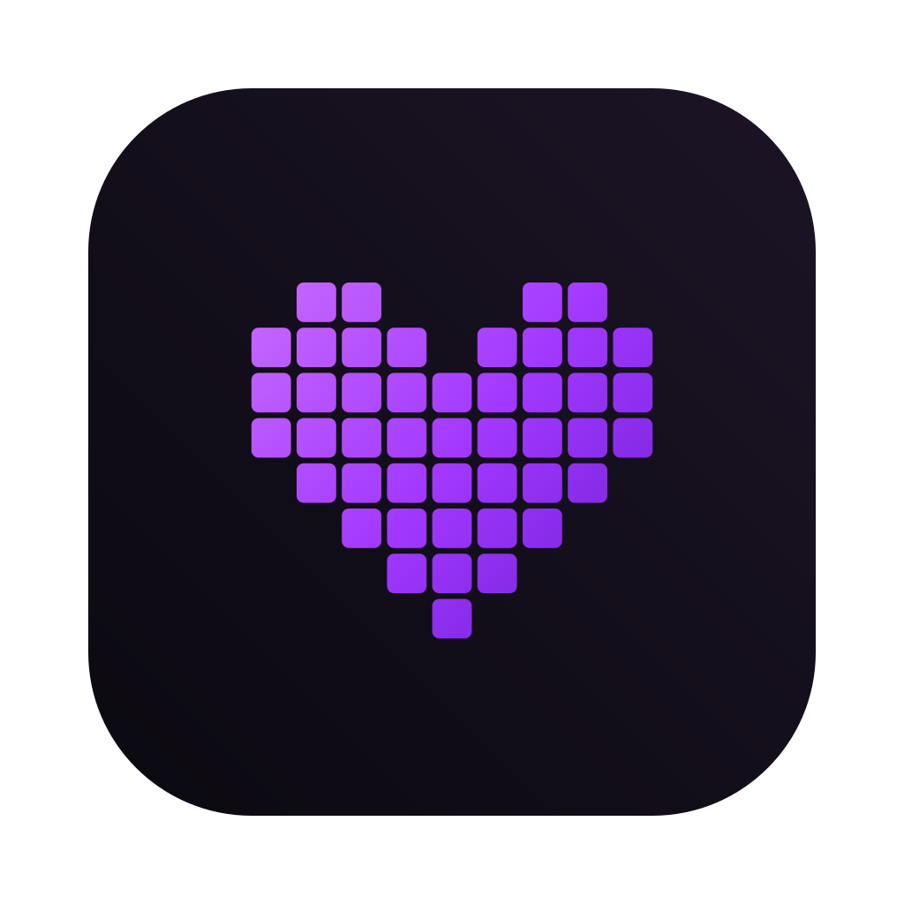

# dzr

<p align="center"></p>

Unofficial Deezer clients for Android and macOS. Personal project, not affiliated with Deezer.

| App | Path | Stack |
| --- | --- | --- |
| Android | `android/` | Kotlin, Jetpack Compose, Material 3 Expressive, Media3 |
| macOS | `macos/` | Swift, SwiftUI (macOS 26 Liquid Glass), AVFoundation |

Downloads are on the [releases page](https://github.com/andymitch/dzr/releases): a zipped `dzr.app` and an arm64 Android APK.

## Features

Both apps:

- Sign in with Deezer's TV code flow (approve a short code at dzr.fm/tv)
- Home with Recently played, Flow and its moods, Discovery and Inspired by mixes, recommended playlists
- Search for tracks, artists, albums and playlists
- Library: liked songs, recently played, playlists, albums, artists
- Streaming in FLAC, 320 kbps or 128 kbps
- Artist Mix and Track Mix, synced lyrics, likes
- Create, rename and delete playlists and add or remove tracks

macOS:

- Menu bar mini player, optional menu-bar-only mode
- Up Next with Play Next, drag to reorder and remove
- Appearance and accent colour settings, including an accent that follows the album artwork

Android:

- Accent colours over black and white, Wallpaper colours, and a pure black (OLED) mode
- Three navigation styles, including one without a bottom bar
- Save a Track Mix as a playlist

## How it talks to Deezer

Both apps sign in with Deezer's TV device login and use the endpoints Deezer's TV and Cast apps use:

- `connect.deezer.com/2.0/smartlogin` issues and polls the login code
- `api.deezer.com/platform/generic/...` and `platform/gcast/...` serve Flow, mixes, library, search, lyrics and likes
- `platform/gcast/track/{id}/streamUrls` returns plain MP3 and FLAC URLs
- The public `api.deezer.com` REST API handles history, artist radio, liked dates and playlist editing

Streaming needs a paid Deezer plan, and any of this can stop working if Deezer changes those endpoints. The macOS app stores its session at `~/Library/Application Support/dzr/session.json` (readable only by you); Android keeps its own.

## Build

```sh
# macOS 26+. Command Line Tools are enough.
cd macos && ./bundle.sh && open build/dzr.app

# Android (JDK 21, Android SDK)
cd android && ./gradlew :app:assembleDebug     # debug build
cd android && ./gradlew :app:assembleRelease   # release build, signed if keystore.properties exists
```

Release signing reads `android/keystore.properties` (git-ignored):

```properties
storeFile=/path/to/release.jks
storePassword=...
keyAlias=...
keyPassword=...
```

Without it the release build is unsigned.

## Credits

The Android app started as a fork of [Pixer](https://github.com/Minuga-RC/Pixer), which is based on [PixelPlayer](https://github.com/PixelPlayerHQ/PixelPlayer). Both are MIT licensed; their copyright notices are kept in `android/LICENSE` and the bundled third-party notices.

## License

MIT
